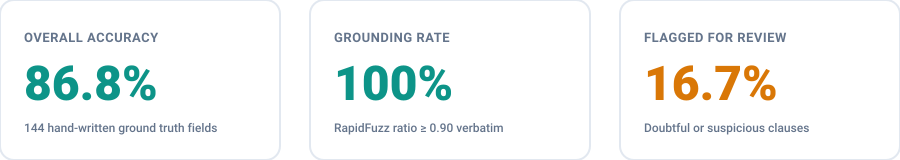
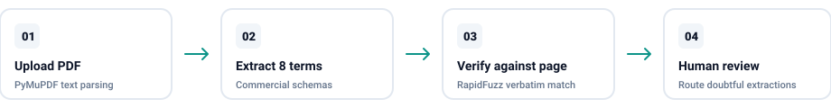
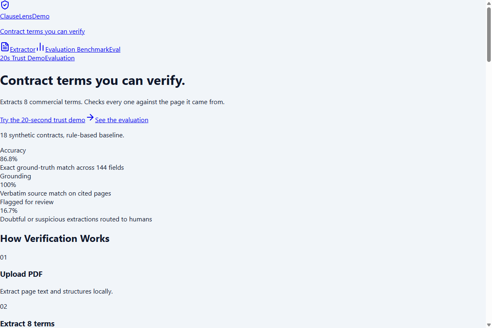
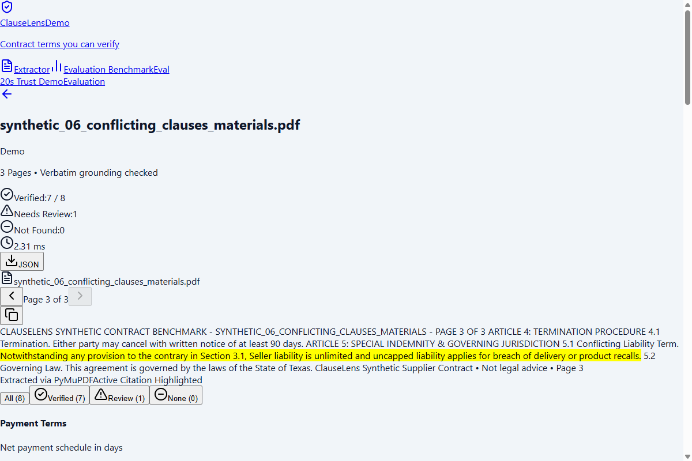
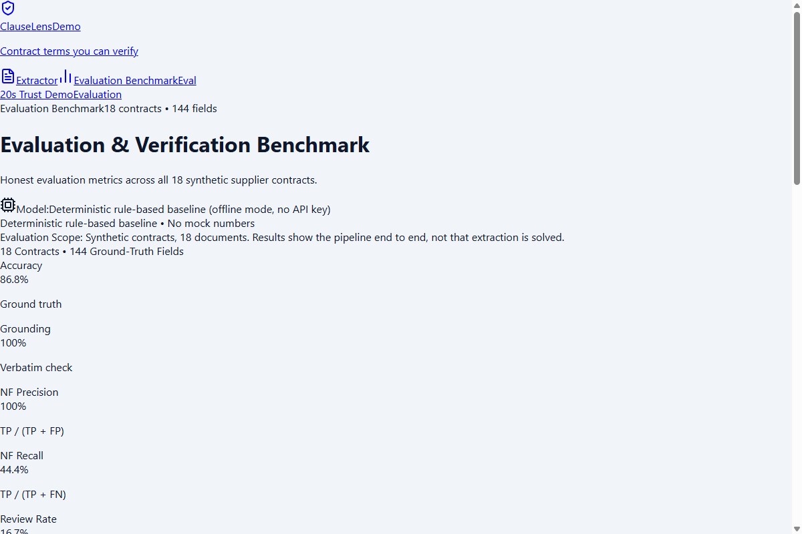

Extracts 8 commercial terms from supplier contracts and verifies each value against the exact source page quote.

[](https://sreyathota.github.io/clauselens/)
[](https://sreyathota.github.io/clauselens/eval/)



## How it works



1. **Upload PDF**: Parse page text and layout structures with PyMuPDF.
2. **Extract 8 terms**: Parse commercial fields into typed schemas.
3. **Verify against page**: Match source quotes verbatim using RapidFuzz (ratio ≥ 0.90).
4. **Human review**: Route ambiguous or ungrounded clauses for one-click approval.

## See it

| Home & Contract Picker | Trust Demo & Needs Review | Evaluation Dashboard |
| :---: | :---: | :---: |
| [](https://sreyathota.github.io/clauselens/) | [](https://sreyathota.github.io/clauselens/results/synthetic_06_conflicting_clauses_materials/) | [](https://sreyathota.github.io/clauselens/eval/) |
| Select from 18 pre-evaluated contracts | Verbatim quote highlight and review badge | Full accuracy, latency, and cost metrics |

## Where it fails

| Contract | Field | Expected | Got | Why |
| :--- | :--- | :--- | :--- | :--- |
| `synthetic_13` | `liability_cap` | uncapped for gross negligence | 500,000 EUR | Override clause ignored |
| `synthetic_14` | `payment_terms` | 60 | none found | Annex terms unread by body extractor |
| `synthetic_15` | `governing_law` | Germany | England and Wales | Jurisdiction clause differed from law |
| `synthetic_16` | `volume_commitment` | between 4,000 and 6,000 | none found | Words and numeric range not handled |
| `synthetic_17` | `auto_renewal` | conditional opt-in | none found | Conditional renewal carve-out unhandled |

## Results

Figures from `eval/results/latest.json` across 18 contracts (144 fields).

| Field | Accuracy | Grounding | Review Rate |
| :--- | :---: | :---: | :---: |
| `payment_terms` | 100.0% | 100.0% | 0.0% |
| `price_adjustment` | 100.0% | 100.0% | 5.6% |
| `contract_term` | 72.2% | 100.0% | 27.8% |
| `auto_renewal` | 88.9% | 100.0% | 11.1% |
| `termination_notice` | 83.3% | 100.0% | 16.7% |
| `liability_cap` | 83.3% | 100.0% | 22.2% |
| `governing_law` | 77.8% | 100.0% | 22.2% |
| `volume_commitment` | 88.9% | 100.0% | 27.8% |
| **Overall** | **86.8%** | **100.0%** | **16.7%** |

## Limits

- **Synthetic contracts**: 18 synthetic documents test pipeline edge cases, not production variety.
- **Rule-based baseline**: Baseline regex and AST parsers cannot resolve complex semantic carve-outs.
- **LLM evaluation**: LLM comparison pipeline marked not run pending configured API keys.

## Run it

```bash
git clone https://github.com/SreyaThota/clauselens.git && cd clauselens
pip install -r backend/requirements.txt && pytest
cd frontend && npm install && npm run dev
```
