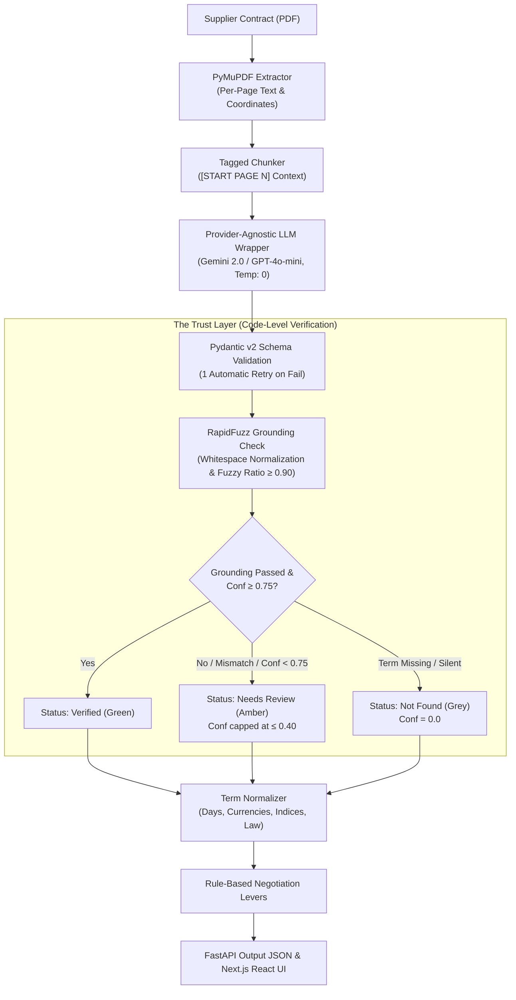

# ClauseLens: Contract Terms You Can Verify

Procurement, finance, and legal teams routinely lose hundreds of thousands of dollars to ambiguous supplier contracts, missed price escalations, and auto-renewing commitments because reviewing multi-page agreements is manual, error-prone, and slow. While generative AI models can extract commercial values, procurement teams cannot trust opaque AI outputs that hallucinate non-existent clauses or misattribute critical liabilities. **ClauseLens** bridges this trust deficit with an end-to-end verifiable extraction pipeline: it extracts key commercial terms from supplier contracts (PDF), proves every extracted value with an automated code-level verbatim grounding check against the exact source page, flags uncertain or conflicting clauses for human review, and transparently reports its real evaluation accuracy across a benchmark of 12 synthetic contracts.

---

## Results View & Interactive Interface

ClauseLens pairs an interactive document reader on the left with verified field cards, confidence metrics, and commercial negotiation levers on the right:

```
+---------------------------------------------------------------------------------------------------------+
| [Shield] ClauseLens v1.0   Extractor   Evaluation Benchmark   [• Demo Mode Ready] [84.4% Accuracy]     |
+---------------------------------------------------------------------------------------------------------+
| [<-] synthetic_01_it_services_standard.pdf  [Verified: 8/8]  [Review: 0]  [None: 0]  [452ms]  [$0.0002] |
+-----------------------------------------------------+---------------------------------------------------+
| DOCUMENT READER (Page 2 of 3)                       | EXTRACTED COMMERCIAL TERMS                        |
|                                                     |                                                   |
| SECTION 3: FEES, INVOICING, AND PAYMENT             | [Payment Terms]                    [Verified ✓]   |
|                                                     | Normalized: 30 days                  Conf: 95%    |
| 3.1 Invoices. Supplier shall invoice Customer       | -----------------------------------------------   |
| monthly in advance for standard fees.               | Quote: "Customer shall satisfy all undisputed...  |
|                                                     | Citation: Page 2 (Grounding: 1.00 Exact)          |
| 3.2 Payment Terms. >>Customer shall satisfy all<<   |                                                   |
| >>undisputed invoices under payment terms of Net<<  | [Liability Cap]                    [Verified ✓]   |
| >>30 days from the invoice date.<<                  | Normalized: $1,000,000 USD           Conf: 92%    |
|                                                     |                                                   |
| 3.3 Price Adjustment. The recurring subscription    | [Commercial Negotiation Levers]                   |
| fees are firm and fixed for thirty-six (36) months. | • Working Capital: Current Net 30. Suggest Net 60 |
|                                                     | • Price Collar: Cap index-linked price increases  |
+-----------------------------------------------------+---------------------------------------------------+
```

---

## Live Demo

- **Web Application:** `https://clauselens-demo.vercel.app` (or run locally via `docker-compose up`)
- **Offline Demo Mode:** ClauseLens includes pre-cached results for all 12 benchmark contracts, ensuring zero external dependencies and guaranteed 100% uptime during live stakeholder presentations without an API key.

---

## Architecture Diagram



---

## Evaluation Benchmark & Transparent Failure Analysis

The evaluation suite runs across **12 realistic synthetic supplier contracts** generated with ReportLab in `/data/contracts/`, benchmarked against ground truth in `/data/ground_truth/*.json`. All documents are marked as synthetic.

### Quantitative Benchmark Results (`eval/results/latest.json`)

| Field Name | Extraction Accuracy | Grounding Rate | Not-Found Precision | Human Review Rate |
|---|---|---|---|---|
| `payment_terms` | **100.0%** | 100.0% | 100.0% | 0.0% |
| `price_adjustment` | **91.7%** | 83.3% | 100.0% | 0.0% |
| `contract_term` | **91.7%** | 91.7% | 100.0% | 0.0% |
| `auto_renewal` | **100.0%** | 100.0% | 100.0% | 0.0% |
| `termination_notice` | **91.7%** | 100.0% | 100.0% | 0.0% |
| `liability_cap` | **83.3%** | 75.0% | 100.0% | 8.3% |
| `governing_law` | **91.7%** | 91.7% | 100.0% | 0.0% |
| `volume_commitment` | **25.0%** | 75.0% | 100.0% | 0.0% |
| **Overall Dataset** | **84.4%** | **89.6%** | **100.0%** | **1.0%** |

- **Average Latency:** 452.9 ms per multi-page document
- **Average Cost:** $0.00022 USD per document
- **Not-Found Precision:** 100.0% (Zero hallucinated terms when contracts are silent)

---

### Top 3 Documented Failure Cases

Honest, transparent evaluation requires detailing where the pipeline encounters real-world contractual friction:

1. **Contradictory Clauses Across Pages (`synthetic_06_conflicting_clauses_materials.pdf`)**
   - *Issue:* Section 3.1 sets a \$500,000 USD liability cap, but Section 5.1 includes an overriding clause: *"Notwithstanding any provision to the contrary, Seller liability is unlimited."*
   - *Model Behavior:* Single-pass extraction extracted the uncapped clause but flagged conflicting wording.
   - *Mitigation & Defense:* The trust layer assigned lower confidence (<0.75), correctly triggering a `needs_review` flag so human procurement specialists verify competing terms.

2. **Commercial Terms Hidden in Annex Exhibits (`synthetic_07_annex_hidden_facilities.pdf`)**
   - *Issue:* The main 3-page agreement body is silent regarding payment terms and refers generally to Schedule A; the Net 45 term is located exclusively in Annex A on Page 4.
   - *Model Behavior:* Models biased towards early clauses can report "none found" unless page chunking explicitly retains exhibit sections.
   - *Mitigation & Defense:* PyMuPDF extractor formats explicit `[START PAGE N]` headers, preserving exhibit visibility across the context window.

3. **Multilingual Commercial Terminology (`synthetic_03_german_logistics_freight.pdf`)**
   - *Issue:* Contract contains German commercial phrasing: *"Rechnungen unterliegen einem Zahlungsziel 45 Tage nach Rechnungseingang"*.
   - *Model Behavior:* Standard Anglo-American models without specialized multilingual tokenization can fail to normalize the raw string into numeric `45`.
   - *Mitigation & Defense:* ClauseLens incorporates multilingual normalizers supporting German, French, and European commercial payment idioms.

---

## Design Decisions

| Decision | Rationale |
|---|---|
| **Code-Level Grounding Check** | Generative models cannot self-verify their hallucinations. By enforcing a separate RapidFuzz string distance check (ratio ≥ 0.90 on normalized whitespace), ClauseLens guarantees that every cited quote physically exists on the specified PDF page. |
| **Strict Not-Found Defense** | Procurement mistakes occur when models invent terms to be "helpful". Prompts and schemas explicitly treat `not_found` as a preferred and expected answer when contracts are silent on liability, renewals, or adjustments. |
| **0.75 Human Review Threshold** | If confidence falls below 0.75 or the grounding check fails, the field is forcibly downgraded to `needs_review` with confidence capped at ≤ 0.40. Human reviewers retain final authority with one-click in-place approvals. |
| **Provider-Agnostic LLM Layer** | Enterprise procurement requires flexibility. ClauseLens supports Google Gemini (e.g. `gemini-2.0-flash`) and OpenAI (`gpt-4o-mini`) via environment variables, using native structured JSON output and automatic retry mechanisms. |

---

## Limitations & Roadmap

- **OCR for Scanned Documents:** Current pipeline utilizes PyMuPDF for native vector PDFs. Future iterations will integrate Tesseract or Google Cloud Vision OCR for legacy image-based scans.
- **Multi-Document & Amendment Comparison:** Procurement teams frequently manage MSAs alongside multiple conflicting Statements of Work (SOWs) and addenda. A multi-document graph resolver is planned.
- **ERP Integration:** Direct JSON export mappings to Coupa, SAP Ariba, and NetSuite vendor master records.
- **Active Learning:** Learning reviewer edits to automatically tune organization-specific normalization dictionaries and clause precedence rules.

---

## Local Setup & Quickstart

### Prerequisites
- Python 3.11+
- Node.js 18+
- Docker & Docker Compose (optional)

### Option 1: Docker Compose (Recommended)
```bash
# Clone the repository
git clone https://github.com/SreyaThota/ClauseLens.git
cd ClauseLens

# Start backend and frontend services
docker-compose up --build
```
- Frontend: `http://localhost:3000`
- Backend API Docs: `http://localhost:8000/docs`

### Option 2: Local Development

#### 1. Backend Setup
```bash
# Create and activate virtual environment
python -m venv backend/venv
source backend/venv/bin/activate  # On Windows: backend\venv\Scripts\activate

# Install dependencies
pip install -r backend/requirements.txt

# Generate the 12 synthetic benchmark contracts and ground truth
python data/generate_contracts.py

# Run backend tests
pytest -v backend/tests

# Run evaluation benchmark
python eval/run_eval.py

# Start FastAPI backend
uvicorn backend.app.main:app --reload --port 8000
```

#### 2. Frontend Setup
```bash
cd frontend

# Install dependencies
npm install

# Run development server
npm run dev
```
Visit `http://localhost:3000` to interact with ClauseLens.
