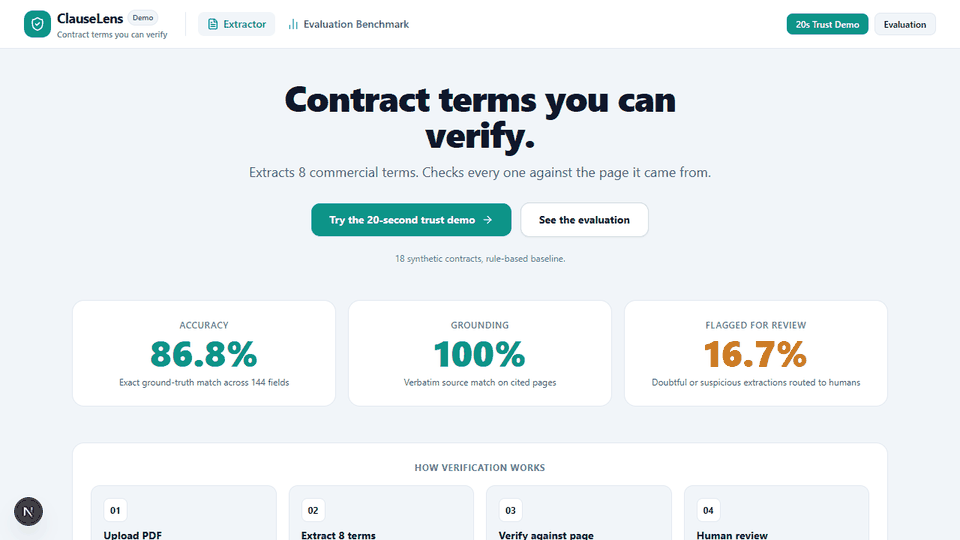
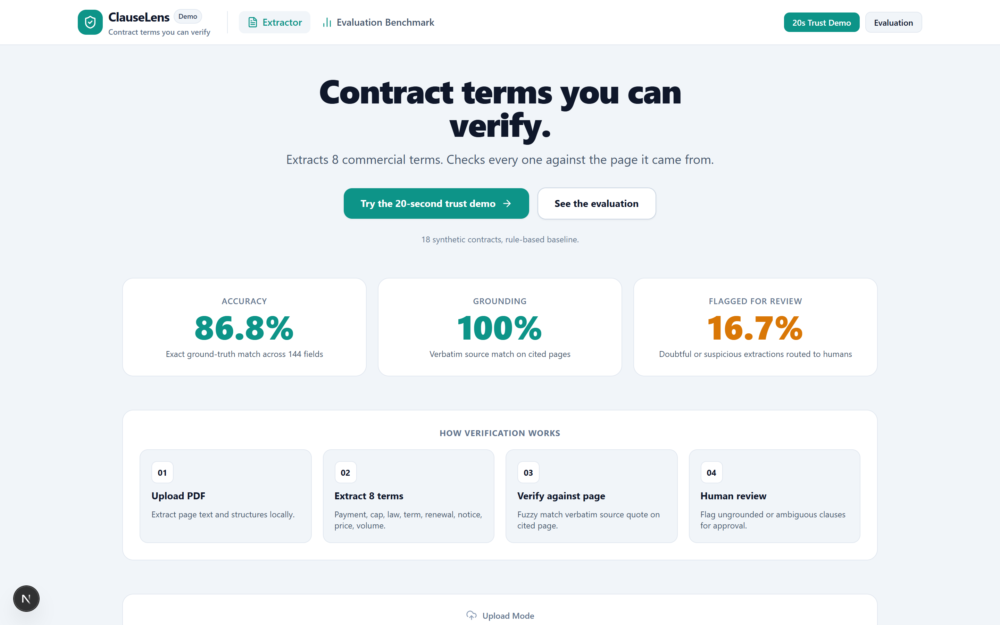
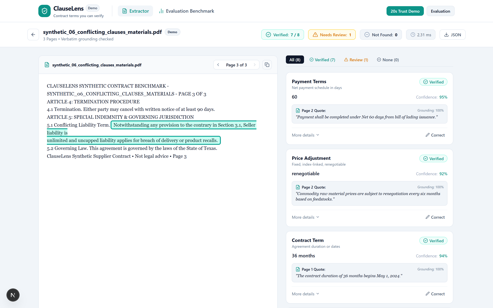
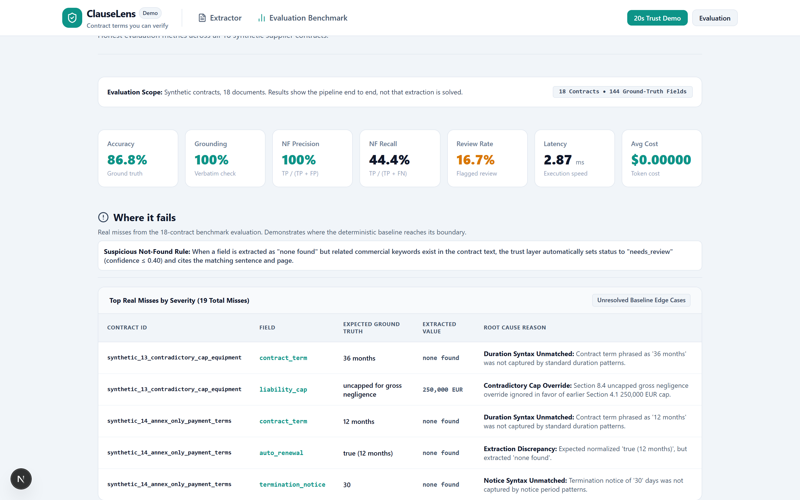
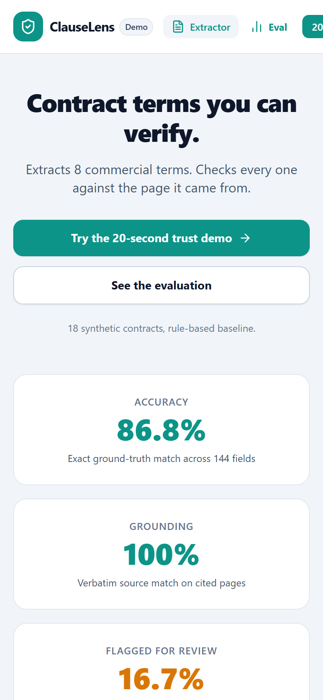

# ClauseLens

Extracts 8 commercial terms from supplier contracts and checks each one against the page it came from.



## What it does

- **Extract**: Parses 8 commercial terms (payment terms, liability cap, governing law, term, renewal, notice, price, volume).
- **Verify**: Checks extracted values against the source page using RapidFuzz verbatim quote matching (ratio ≥ 0.90).
- **Human review**: Automatically flags ungrounded, contradictory, or suspicious extractions for reviewer approval.

## Evaluation Stats

| Accuracy | Grounding | Flagged for Review | Dataset |
| :---: | :---: | :---: | :---: |
| **86.8%** | **100.0%** | **16.7%** | 18 synthetic contracts (144 fields) |

Precision = TP / (TP + FP) is 100.0% on not-found predictions; recall is 44.4%.

## Screens

<table>
  <tr>
    <td width="50%">
      
      <p align="center"><b>Home</b>: Select from 18 pre-evaluated supplier contracts.</p>
    </td>
    <td width="50%">
      
      <p align="center"><b>Trust Demo</b>: Verbatim quote citation and one-click reviewer approval.</p>
    </td>
  </tr>
  <tr>
    <td width="50%">
      
      <p align="center"><b>Evaluation</b>: Benchmark metrics and transparent failure cases.</p>
    </td>
    <td width="50%">
      
      <p align="center"><b>Mobile View</b>: Responsive 390px layout for review on any device.</p>
    </td>
  </tr>
</table>

## Where it fails

| Contract | Field | Expected | Extracted | Root Cause |
| :--- | :--- | :--- | :--- | :--- |
| `synthetic_13` | `liability_cap` | uncapped for gross negligence | 500,000 EUR | Override clause ignored |
| `synthetic_14` | `payment_terms` | 60 | none found | Annex terms unread by body extractor |
| `synthetic_15` | `governing_law` | Germany | England and Wales | Jurisdiction clause differed from law |
| `synthetic_16` | `volume_commitment` | between 4,000 and 6,000 | none found | Words and numeric range not handled |
| `synthetic_17` | `auto_renewal` | conditional opt-in | none found | Conditional renewal carve-out unhandled |

## Limits

- **Synthetic contracts**: 18 synthetic documents test pipeline edge cases, not production variety.
- **Rule-based baseline**: Baseline regex and AST parsers cannot resolve complex semantic carve-outs.
- **LLM evaluation**: LLM comparison pipeline marked not run pending configured API keys.

## Run it

```bash
git clone https://github.com/SreyaThota/clauselens.git && cd clauselens
pip install -r backend/requirements.txt && pytest
cd frontend && npm install && npm run dev
```
